# Example: connect NucleiSky to a microscope

> **This is a worked example**, written for one setup: a Nikon microscope with NIS-Elements AR 6.20 and its JOBS module. On another microscope the steps differ, but the idea is the same: install the app's environment where the microscope software can reach it, and point the software's Python step at it.

The microscope scans a large area, NucleiSky finds where a query image sits in it, and the microscope then acquires that place at high resolution. NIS-Elements AR includes [JOBS](https://www.microscope.healthcare.nikon.com/en_EU/products/software/nis-elements/nis-elements-jobs) as a feature to automate image acquisition and analysis, enabling integration with Python and, therefore, NucleiSky. 

This tutorial is divided into two main sections. The [first section](#setup) covers the setup of the JOBS workflow, which only needs to be done once. The [second section](#run-the-jobs) explains how to run the workflow, which must be done each time you use it.

## Setup

Before starting to use the JOBS, be sure that you have correctly loaded everything and configured your microscope settings in the NIS-Elements AR software.

### Step 1: Install the NucleiSky environment

The best approach we found to address all the limitations of our facility (no internet connection, no admin privileges, and no installation of unwanted software on the microscope computer) was to package NucleiSky into a defined Conda environment, install it on a USB stick, bring the stick to the microscope, and point NIS-Elements JOBS to the Python executable in that environment.

Thanks to [LabConstrictor](https://github.com/CellMigrationLab/LabConstrictor), we were able to install NucleiSky and all its dependencies into the USB stick using the provided executable installer.

#### 1. Install NucleiSky on a USB stick

In order to achieve this, you can follow the regular [installation instructions](https://cellmigrationlab.github.io/LabConstrictor-Site/guides/install/), BUT on the step where you are asked to select the installation folder, you should select the USB stick instead of your computer: 

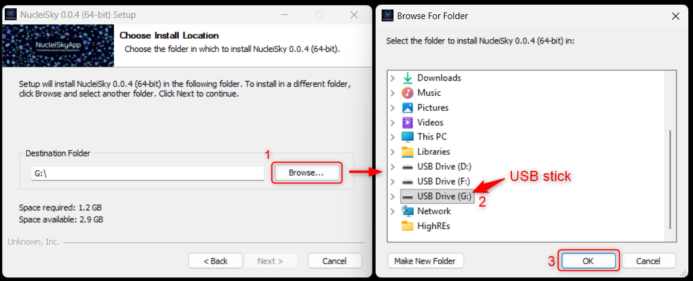

> **Warning**: In our experience, this might take a long time to install, so be patient and wait for the installation to finish or let it install overnight.

#### 2. Include NIS-Elements packages in the USB NucleiSky environment

 - Take the USB stick and connect it to the microscope computer where NIS-Elements AR is installed. 
 - In the File Explorer, go to `C:\Program Files\NIS Elements\Python\Lib\site-packages`. There, copy `limnode.py` and `limtabledata.py`.
 - Paste those files into the `site-packages` folder of the NucleiSky environment in the USB stick. The path should look like this: `<drive>:\nucleisky\Lib\site-packages`, where `<drive>` is the letter Windows gave the USB stick (for example `E`).

In [Step 3](#step-3-adjust-it-to-your-microscope-and-camera-settings), we will show you how to configure the NucleiSky environment as the Python interpreter for the JOBS GA3 workflow. 

### Step 2: Load the JOBS and GA3 into your NIS-Elements AR software

#### 1. Download the JOBS and GA3 files

Download the two files below, then take them to the computer where you have NIS-Elements AR installed:

- JOBS file: [NucleiSky_JOBS.bin](https://github.com/CellMigrationLab/NucleiSky/raw/main/smart_microscopy/NucleiSky_JOBS.bin)
- GA3 file: [NucleiSky_GA3.ga3](https://github.com/CellMigrationLab/NucleiSky/raw/main/smart_microscopy/NucleiSky_GA3.ga3)

> To look at the JOBS workflow before you import it, open its [interactive preview](https://htmlpreview.github.io/?https://github.com/CellMigrationLab/NucleiSky/blob/main/docs/smart_microscopy/assets/JOBS_HTML.html) (a third-party page that displays the HTML file from this repository).

> To look at the GA3 workflow, open its [interactive preview](https://htmlpreview.github.io/?https://github.com/CellMigrationLab/NucleiSky/blob/main/docs/smart_microscopy/assets/GA3_HTML.html).

#### 2. Open NIS-Elements AR and go to the JOBS tab

On the top menu of the NIS-Elements AR software, click on the JOBS tab and click on `Create New JOB...`
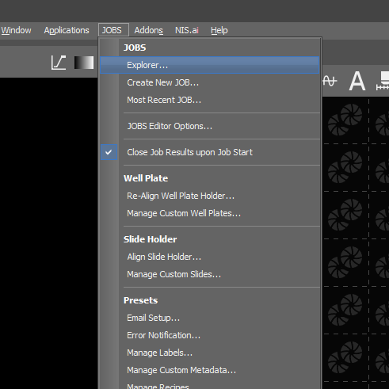

This should open a new window with an empty JOB like this:
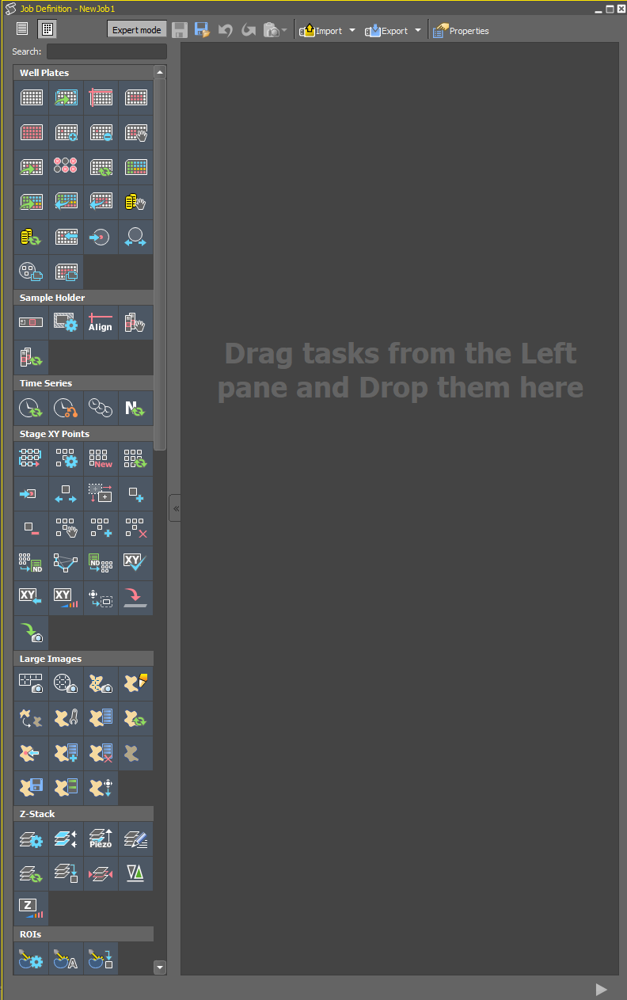

#### 3. Import the downloaded JOBS file

On the JOB window, click on the `Import` button and select the downloaded JOBS file:

This should load the JOBS file, and you should see the following window:

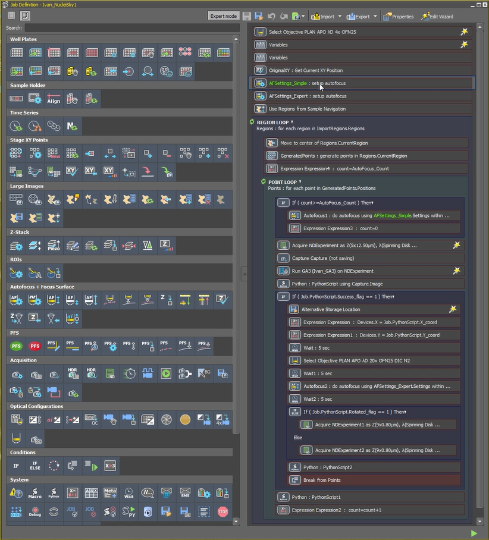

#### 4. Import the downloaded GA3 file

Once the JOBS files are correctly loaded, click the `Run GA3 (...) on ...` step (the name in brackets is the GA3 analysis it currently uses) to display the following window:

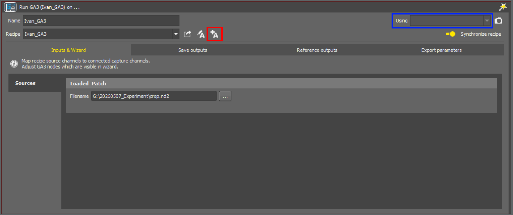

On that window, there are two important aspects to consider:

- The `+A` button is marked with a red square. Click here to add the downloaded GA3 file to the JOBS.
- The `Using` drop-down menu is marked with a blue square. It refers to the image to use in the GA3 workflow, and it should point to `NDExperiment`. If it is not, click the drop-down menu and select `NDExperiment`.

### Step 3: Adjust it to your microscope and camera settings

After correctly loading the JOBS and GA3 files, you will need to adjust them to your microscope and camera settings. The following steps are required:

#### 1. Define the optical configuration of your experiment

This is an important step because it defines the acquisition parameters of the JOBS workflow, such as wavelengths, exposure times, and laser power. These settings will affect the final image quality and the amount of photodamage caused during acquisition.

We recommend using two different configurations: one for scanning the large area and another for acquiring the final high-resolution image.

* **Scanning nuclei configuration**: this configuration is used to scan a large area with a low-magnification objective. The goal is to obtain images of sufficient quality to clearly identify and segment the nuclei, while minimising photodamage.
* **Final acquisition configuration**: this configuration is used to acquire the final images with the high-magnification objective. Here, you should define all the channels you want to acquire and adjust the exposure time and laser power to achieve the best possible image quality.

We recommend asking your microscopy facility for help, or at least manually validating these configurations before running the JOBS workflow. Below are the scanning and final acquisition configurations we used:

#### 2. Adjust the JOBS parameters to point to your settings

The JOBS workflow will not work unless all parameters point to a valid configuration. Not all the parameters need to be adjusted, and most probably, when loading the JOBS file, it will indicate in red the parameters that are not correctly set.

Here we provide some screenshots and instructions of the parameters that we think need to be adjusted (if you find any others, please let us know by [creating an issue](https://github.com/CellMigrationLab/NucleiSky/issues/new)):

**Select Objective:**

In our case, we had a Plan Apo $\lambda D$ $4 \times$ OFN25. But in your microscope you might have a different objective, click on the drop-down menu and select the one you want to use for scanning the large area. As long as nuclei can be detected, we recommend using a low-magnification objective to speed up scanning.

**Auto Focus Settings Simple:**

The simple autofocus settings are used for large-area scanning. For that reason, this is just a simple autofocus configuration with a $300 \mu m$ range. 

Here, in the `Use OC` section, you should select the optical configuration you defined in [Define the optical configuration](#1-define-the-optical-configuration-of-your-experiment) for scanning the nuclei in the large area. The other parameters can be left as they are.

**Auto Focus Settings Expert:**

The expert auto focus settings are used for the final acquisition of the high-resolution image. For that reason, this is a double-pass autofocus with a longer $500 \mu m$ range.

Here on the `Use OC` section, you should select the optical configuration you defined in [Define the optical configuration](#1-define-the-optical-configuration-of-your-experiment) for the final acquisition of the high-resolution image. The other parameters can be left as they are.

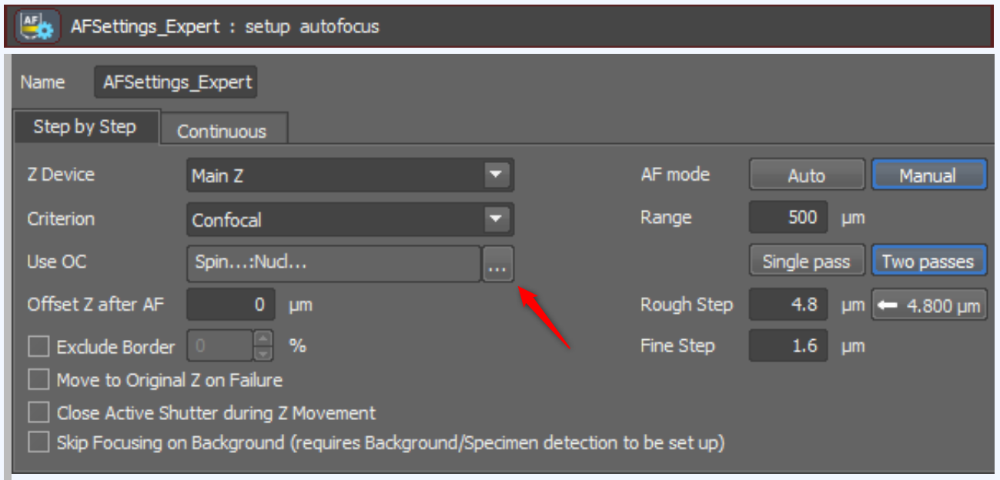

**Acquire NDExperiment:**

The NDExperiment is the acquisition job that acquires a Z-Stack of the nuclei channel and will be used as a reference for NucleiSky re-localisation. 

Here, first you would need to go to the $\lambda$ tab (1). There, you will need to ensure that the optical configuration for Scanning Nuclei with just the nuclei channel is selected (2). Then, you will need to ensure that your microscope is correctly selected (3). Leave the other parameters as they are unless you want to change the Z-Stack settings.

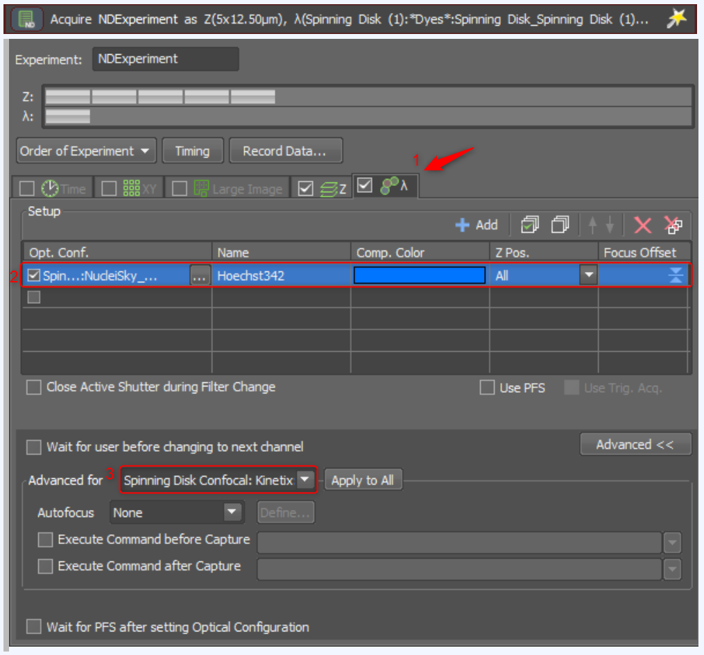

**Run GA3:**

This will continue [4. Import the downloaded GA3 file](#4-import-the-downloaded-ga3-file). As previously explained, ensure that the `Using` drop-down menu is pointing to `NDExperiment` and that the GA3 file is correctly loaded.

Then, click on the `Edit A` to edit the loaded GA3 workflow as it is indicated with a red arrow in the following screenshot:

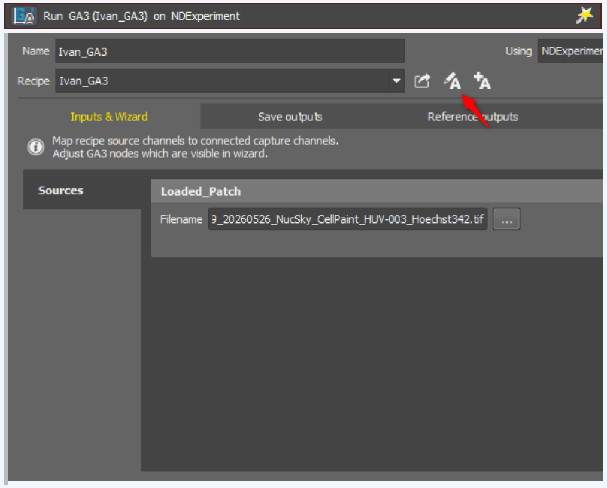

This should open the GA3 window, which should look like this:

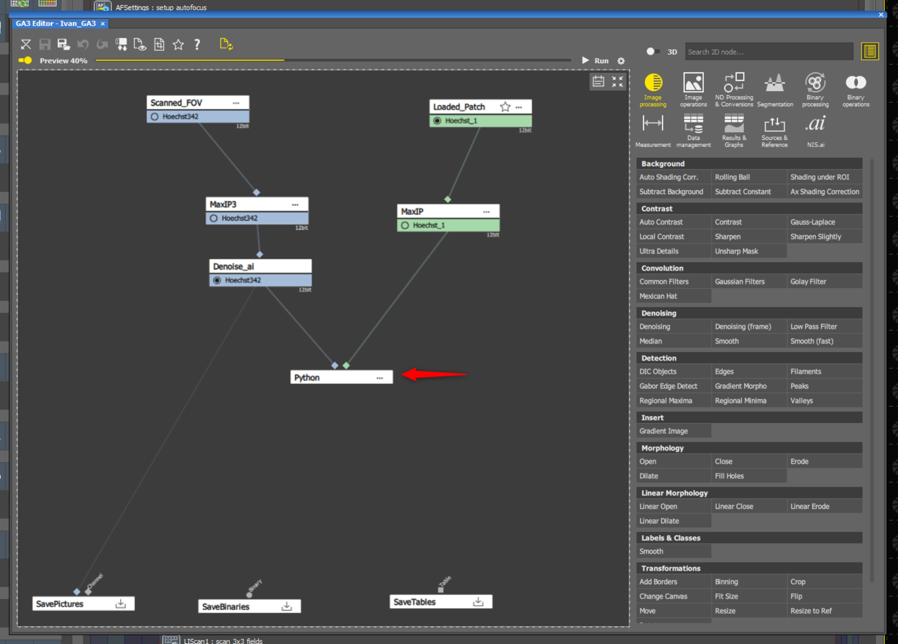

There, as indicated with the red arrow in the previous screenshot, you would need to click on the `Python` block and would open the following window:

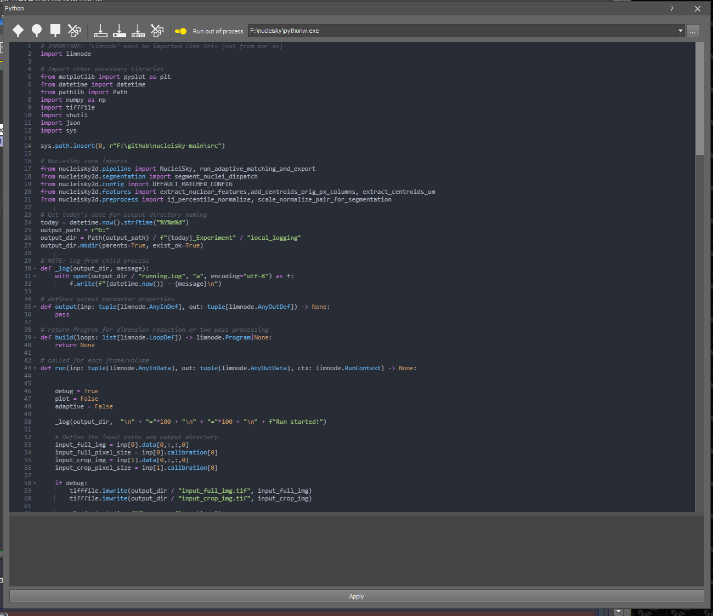

There, the first thing you will need to do is point the Python interpreter to the one in the NucleiSky environment on the USB stick. Remember to follow the instructions on [Step 1](#step-1-install-the-nucleisky-environment). To do that, as indicated in the following screenshot, enable the `Run out of process` toggle (1) and select the Python executable in the NucleiSky environment in the USB stick (2). The path should look like this: `<drive>:\nucleisky\pythonw.exe`.

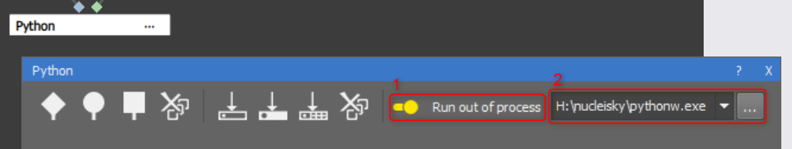

Once that is done, you will need to include the Python code. Most probably, the code will be already loaded, but in case it is not, you can copy and paste the code from the [GA3_Python.py](https://github.com/CellMigrationLab/NucleiSky/blob/main/smart_microscopy/GA3_Python.py) file. 

Once loaded, adjust two lines:

- [`sys.path.insert(0, r"H:\github\nucleisky-main\src")`](https://github.com/CellMigrationLab/NucleiSky/blob/cfa172d7980446db51224423d896746d75dd88e7/smart_microscopy/GA3_Python.py#L14): download the NucleiSky repository to the USB stick and put the path of its `src` folder here, for example `r"<drive>:\nucleisky-main\src"`.
- [`output_path = r"G:"`](https://github.com/CellMigrationLab/NucleiSky/blob/cfa172d7980446db51224423d896746d75dd88e7/smart_microscopy/GA3_Python.py#L25): the folder where the results of each run are saved, on the computer or on the USB stick, for example `r"<drive>:\nucleisky_results"`.

> **Use the same `output_path` in all four scripts.** `PythonScript.py`, `PythonScript1.py` and `PythonScript2.py` (the PythonScript steps below) read the results from that folder, and each has its own `output_path = r"G:"` line. If one of them points elsewhere, the JOB cannot find NucleiSky's answer.

Finally, remember to save it. In order to do that, you will need to save it in three different places: 

1) Click on Apply in the Python window to save the changes in the Python block. This might take a while as it will run the code and check for errors. If you encounter any error, please let us know by [creating an issue](https://github.com/CellMigrationLab/NucleiSky/issues/new).

2) Click on the Save button in the GA3 window to save the changes in the GA3 workflow.

3) Click on the Save button in the JOBS window to save the changes in the JOBS workflow.

**PythonScript:**

This step extracts information from NucleiSky's run and makes it available to the rest of the JOBS workflow. 

Here, as indicated in the following screenshot, you will need to use the `Task Parameters` tab (1) and ensure that these parameters exist (2), with exactly these names and types:

| Name | Type |
|---|---|
| `Success_flag` | Integer |
| `Rotated_flag` | Integer |
| `X_coord` | Double |
| `Y_coord` | Double |

Then, in the `Script` section (3), the code will most likely already be loaded; if not, you can copy and paste it from the [PythonScript.py](https://github.com/CellMigrationLab/NucleiSky/blob/main/smart_microscopy/PythonScript.py) file. Finally, remember to click on the save button (indicated with the red arrow) to save the changes in the PythonScript block.

**Second Select Objective (inside the loop):**

This is the objective used to acquire the final high-resolution image. Here, you should select the objective that you want to use for the final acquisition. 

In our case, we chose a higher magnification objective. Be sure that it is an air objective.

**Acquire NDExperiment1 (final acquisition with rotation detected):**

If NucleiSky has detected a match and it has declared that some rotation is needed for this acquisition, a $3\times3$ grid will be used to acquire the final high-resolution image. 

Here, first, you would need to go to the $\lambda$ tab (1). There, you will need to ensure that the optical configuration for Final Acquisition is defined in [Define the optical configuration](#1-define-the-optical-configuration-of-your-experiment) with all the channels you want to acquire (2). Then, you will need to ensure that your microscope is correctly selected (3). Leave the other parameters as they are unless you want to change the Z-Stack or Large Image settings.

**Acquire NDExperiment2 (final acquisition without rotation detected):**

If NucleiSky has detected a match and declared that no rotation is needed for this acquisition, and there is no grid, it will be used to acquire the final high-resolution image.

Here, you will need to ensure the same settings as in the previous step, but this time, no Large Image is needed, or just validate that the Large Image is $1\times1$.

**PythonScript2:**

Ensure that the code in the Script section is the same as in [PythonScript2.py](https://github.com/CellMigrationLab/NucleiSky/blob/main/smart_microscopy/PythonScript2.py) and otherwise copy and paste it. Then, remember to click on the save button (indicated with the red arrow) to save the changes in the PythonScript2 block.

**PythonScript1:**

Ensure that the code in the Script section is the same as in [PythonScript1.py](https://github.com/CellMigrationLab/NucleiSky/blob/main/smart_microscopy/PythonScript1.py) and otherwise copy and paste it. Then, remember to click on the save button (indicated with the red arrow) to save the changes in the PythonScript1 block.

## Run the JOBS

### Step 1: Select the area to scan

1) Open the Stage Navigator from the `Window` menu.<!-- TODO(NucleiSky authors): give the full menu path in NIS-Elements AR 6.20. -->

2) Select the stage that you are using by clicking on the `Stage` option in the bottom right corner of the Stage Navigator window.

3) Click on the `Preview` button to acquire a preview of the stage. This might take some time.

4) Once the preview is acquired, modify the already given rectangle or draw a new one by clicking on `+ Region` to select the area you want to scan. You can also modify the rectangle by clicking on it and dragging the corners.

### Step 2: Run the JOBS workflow

#### 1. Choose the Wizard input parameters

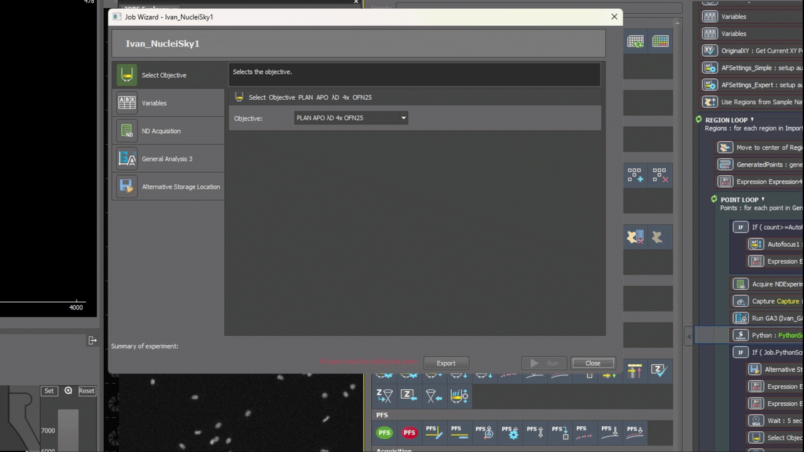

Set these five inputs in the JOBS wizard before you run it:

| Input | What to set |
|---|---|
| **Select Objective** | The objective for scanning the large area. A low magnification scans faster, as long as the nuclei can still be detected. |
| **Variables** | One variable, `AutoFocus_Count`: how often the autofocus runs. The default, 1, focuses at every scanning position. A higher value (set both `Initial Value` and `Current Value`) is faster, but some positions may be out of focus. |
| **NDAcquisition** | Already set if you followed the setup; leave it. |
| **GeneralAnalysis3** | The query image to find in the scanned area: a Z-stack of the nuclei channel. |
| **Alternative Storage Location** | Optional: where JOBS stores its images, if not in the default place. |

#### 2. Let the JOBS workflow run and wait for the results

After setting the input parameters, click on `Run` to start the JOBS workflow. The process will go as follows and you would not need to do anything else:

#### 3. Check the result

When the JOB has finished, open the folder you set as `output_path`. Each finished run has a folder `<date>_Experiment\<time>` (a run that stopped early leaves `<date>_Experiment\local_logging` instead) with:

- `running.log`: what NucleiSky did, ending with a line like `Output values are: Success=1, Rotated=0, BBox Centroid=(...)`. `Success=1` means the query image was found; the stage then moved there and acquired the high-resolution image. `Success=0` means no match was found and no final image was taken.
- `input_full_img.tif` and `input_crop_img.tif`: the scanned area and the query image as NucleiSky received them, with `full_mask.tif` and `crop_mask.tif` (the segmented nuclei) and the tables `full_df.csv` and `crop_df.csv`. The images are written while `debug = True` in `GA3_Python.py` (as shipped).

The final high-resolution images are saved by NIS-Elements, in the JOB's storage location.

If there is no `running.log` at all, NIS-Elements could not start the NucleiSky environment: check the interpreter path from [Run GA3](#2-adjust-the-jobs-parameters-to-point-to-your-settings) and that `limnode.py` and `limtabledata.py` are in its `site-packages` folder.
