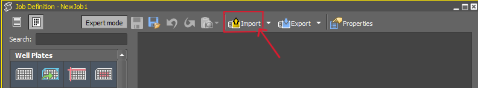
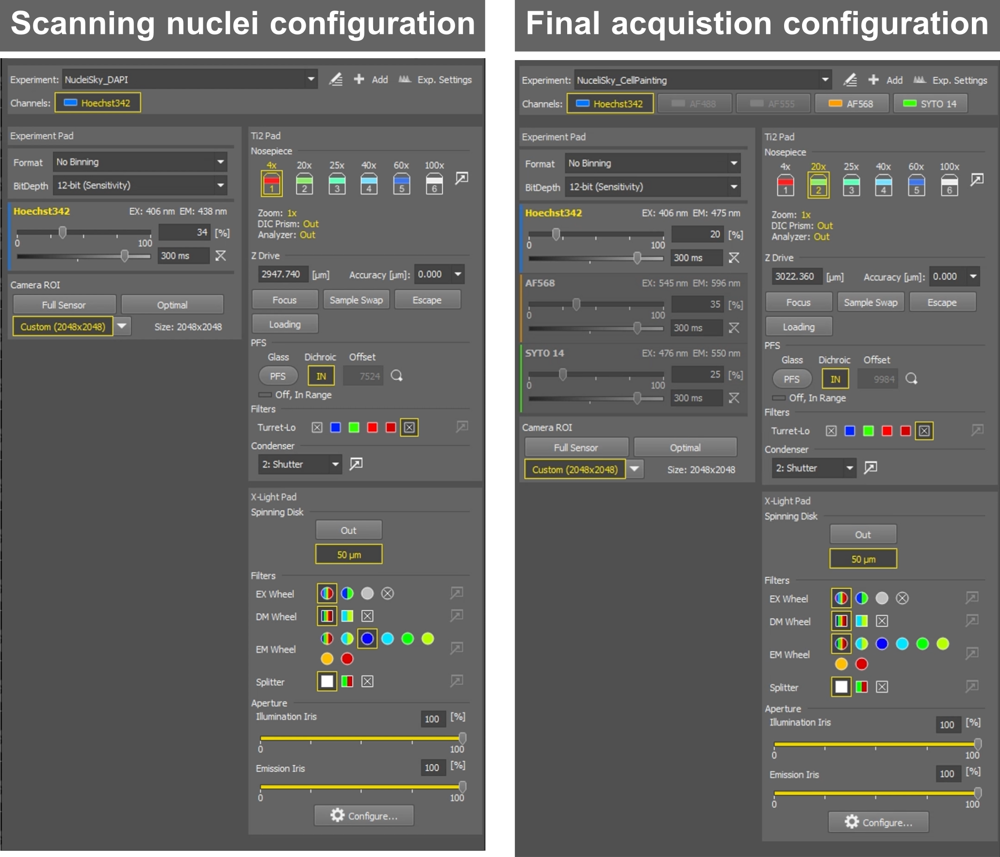
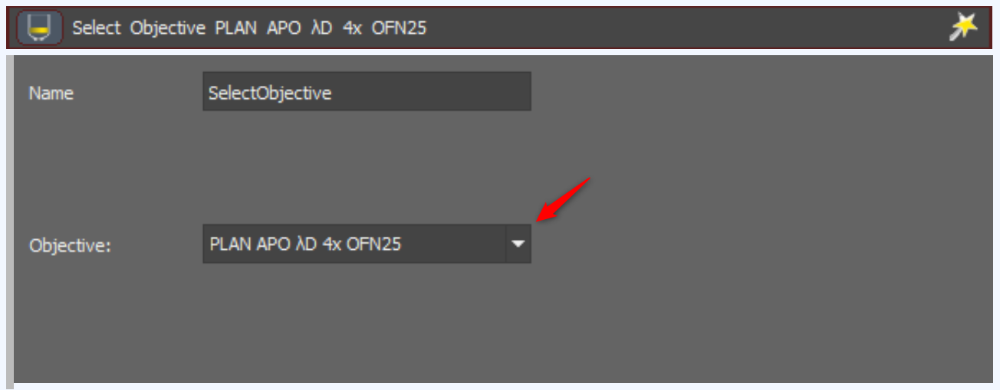
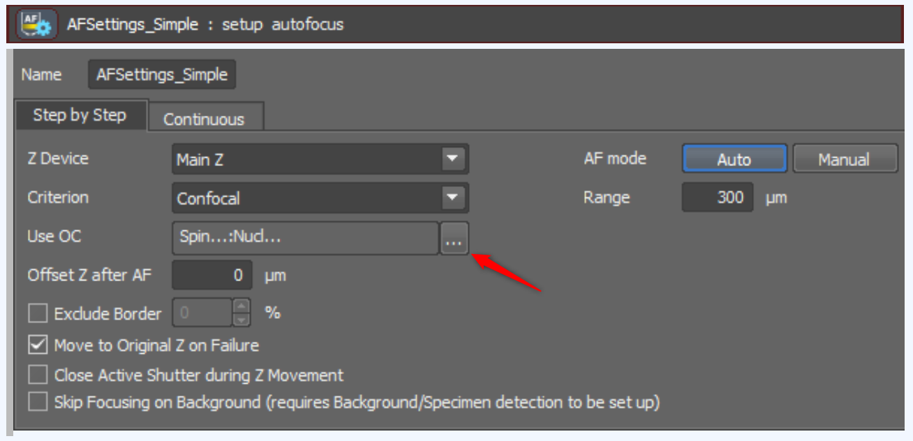
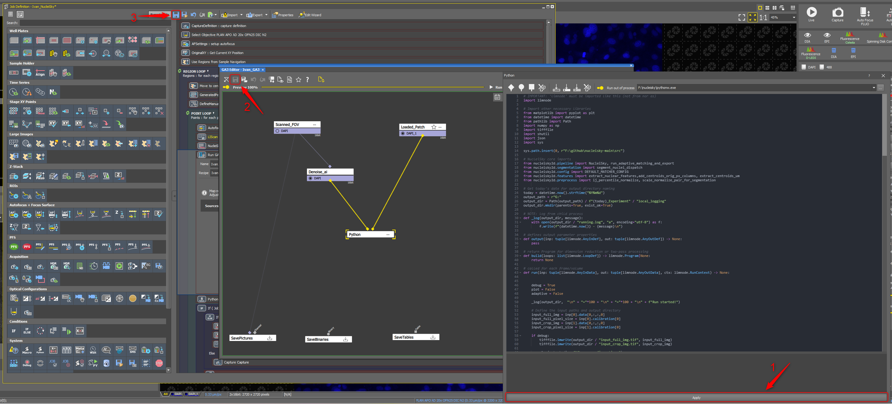
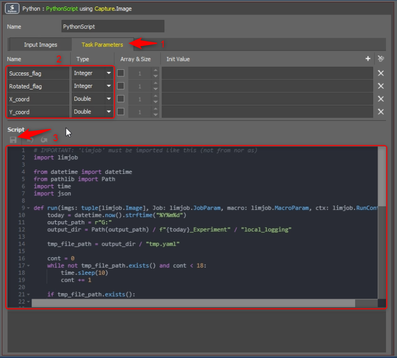
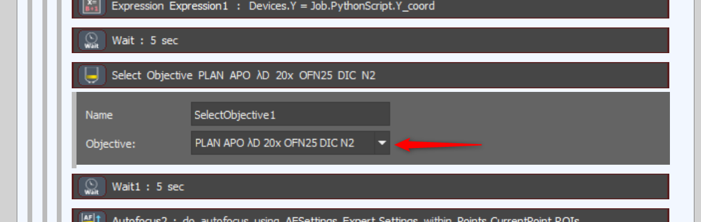
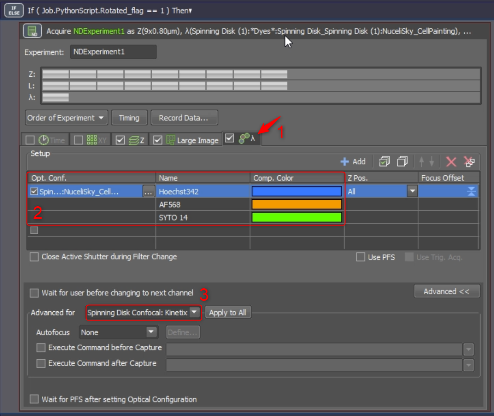
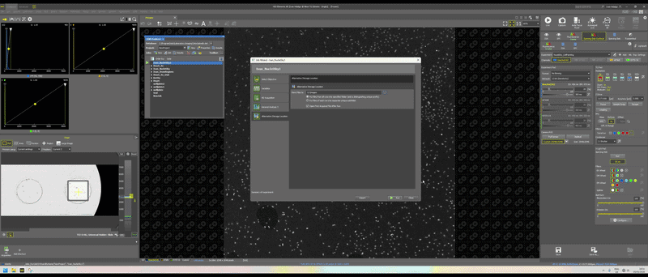

# Example: connect NucleiSky to a microscope

> **This is a worked example**, written for one setup: a Nikon microscope with NIS-Elements AR 6.20 and its JOBS module. On another microscope the steps differ, but the idea is the same: install the app's environment where the microscope software can reach it, and point the software's Python step at it.

The microscope scans a large area, NucleiSky finds where a query image sits in it, and the microscope then acquires that place at high resolution. [JOBS](https://www.microscope.healthcare.nikon.com/en_EU/products/software/nis-elements/nis-elements-jobs), a module of NIS-Elements AR, automates acquisition and analysis and can run Python steps: that is how it calls NucleiSky.

Do the [setup](#setup) once; then [run the JOB](#run-the-jobs) each time you use it.

## Setup

Before you start, check that your microscope and its settings work in NIS-Elements AR.

### Step 1: Install the NucleiSky environment

The microscope computer in our facility has no internet connection, and we could not use admin rights or install other software on it. So we installed NucleiSky's Conda environment on a USB stick, brought the stick to the microscope, and pointed NIS-Elements JOBS to the Python executable in that environment.

The NucleiSky installer, built with [LabConstrictor](https://github.com/CellMigrationLab/LabConstrictor), puts NucleiSky and all its dependencies on the stick.

#### 1. Install NucleiSky on a USB stick

Follow the regular [installation instructions](https://cellmigrationlab.github.io/LabConstrictor-Site/guides/install/), but when the installer asks for the installation folder, select the USB stick:

> **Warning**: Installing on a USB stick can be slow. Let it finish, or leave it to run overnight.

#### 2. Include NIS-Elements packages in the USB NucleiSky environment

 - Connect the USB stick to the microscope computer where NIS-Elements AR is installed.
 - In the File Explorer, go to `C:\Program Files\NIS Elements\Python\Lib\site-packages` and copy `limnode.py` and `limtabledata.py`.
 - Paste them into the `site-packages` folder of the NucleiSky environment on the USB stick: `<drive>:\nucleisky\Lib\site-packages`, where `<drive>` is the letter Windows gave the USB stick (for example `E`).

[Step 3](#step-3-adjust-it-to-your-microscope-and-camera-settings) makes this environment the Python interpreter of the JOBS GA3 workflow.

### Step 2: Load the JOBS and GA3 into your NIS-Elements AR software

#### 1. Download the JOBS and GA3 files

Download the two files below, then copy them to the computer with NIS-Elements AR:

- JOBS file: [NucleiSky_JOBS.bin](https://github.com/CellMigrationLab/NucleiSky/raw/main/smart_microscopy/NucleiSky_JOBS.bin)
- GA3 file: [NucleiSky_GA3.ga3](https://github.com/CellMigrationLab/NucleiSky/raw/main/smart_microscopy/NucleiSky_GA3.ga3)

> To look at the JOBS workflow before you import it, open its [interactive preview](https://htmlpreview.github.io/?https://github.com/CellMigrationLab/NucleiSky/blob/main/docs/smart_microscopy/assets/JOBS_HTML.html) (a third-party page that displays the HTML file from this repository).

> To look at the GA3 workflow, open its [interactive preview](https://htmlpreview.github.io/?https://github.com/CellMigrationLab/NucleiSky/blob/main/docs/smart_microscopy/assets/GA3_HTML.html).

#### 2. Open NIS-Elements AR and go to the JOBS tab

In the top menu of NIS-Elements AR, click the JOBS tab, then `Create New JOB...`.

A new window opens with an empty JOB:

#### 3. Import the downloaded JOBS file

In the JOB window, click `Import` and select the downloaded JOBS file.

The window now shows the NucleiSky JOB:

#### 4. Import the downloaded GA3 file

Click the `Run GA3 (...) on ...` step (the name in brackets is the GA3 analysis it currently uses) to open its settings.

In this window:

- Click `+A` (red square) and add the downloaded GA3 file.
- Check that the `Using` drop-down menu (blue square), the image the GA3 workflow works on, is set to `NDExperiment`. If it is not, select `NDExperiment`.

### Step 3: Adjust it to your microscope and camera settings

Now adapt the JOB and the GA3 workflow to your microscope and camera.

#### 1. Define the optical configuration of your experiment

The optical configurations set the acquisition parameters of the JOB, such as wavelengths, exposure times and laser power. They decide the image quality and how much photodamage the acquisition causes.

Use two configurations: one to scan the large area and one to acquire the final high-resolution image.

* **Scanning nuclei configuration**: scans a large area with a low-magnification objective. The images must be good enough to identify and segment the nuclei, with as little photodamage as possible.
* **Final acquisition configuration**: acquires the final images with the high-magnification objective. Include every channel you want, and adjust exposure time and laser power for the best image quality.

Ask your microscopy facility for help, or at least test both configurations by hand before you run the JOB. These are the configurations we used:

#### 2. Adjust the JOBS parameters to point to your settings

The JOB runs only when every parameter points to a valid configuration. After the import, JOBS usually shows in red the parameters that do not match your microscope.

These are the parameters we expect you to adjust. If you had to change another one, please [open an issue](https://github.com/CellMigrationLab/NucleiSky/issues/new).

**Select Objective:**

Select the objective for scanning the large area (we used a Plan Apo $\lambda D$ $4 \times$ OFN25). A low-magnification objective scans faster, as long as the nuclei can still be detected.

**Auto Focus Settings Simple:**

This autofocus runs while the large area is scanned: a simple autofocus with a $300 \mu m$ range.

In `Use OC`, select your scanning configuration from [Define the optical configuration](#1-define-the-optical-configuration-of-your-experiment). Leave the other parameters as they are.

**Auto Focus Settings Expert:**

This autofocus runs before the final high-resolution image: a double-pass autofocus with a longer $500 \mu m$ range.

In `Use OC`, select your final acquisition configuration from [Define the optical configuration](#1-define-the-optical-configuration-of-your-experiment). Leave the other parameters as they are.

**Acquire NDExperiment:**

This step acquires a Z-Stack of the nuclei channel: the reference in which NucleiSky locates the query image.

Open the $\lambda$ tab (1). Select the scanning configuration, with only the nuclei channel (2), and check that your microscope is selected (3). Leave the other parameters as they are unless you want to change the Z-Stack settings.

**Run GA3:**

This is the step you opened in [4. Import the downloaded GA3 file](#4-import-the-downloaded-ga3-file). Check that `Using` is set to `NDExperiment` and that the GA3 file is loaded.

Select `Edit A` (red arrow) to open the GA3 workflow.

In the GA3 window, click the `Python` block (red arrow).

The Python window opens:

First, point the Python interpreter to the NucleiSky environment on the USB stick (from [Step 1](#step-1-install-the-nucleisky-environment)): enable the `Run out of process` toggle (1) and select the environment's Python executable (2), for example `<drive>:\nucleisky\pythonw.exe`.

Then check the Python code. It is usually already loaded; if not, copy it from [GA3_Python.py](https://github.com/CellMigrationLab/NucleiSky/blob/main/smart_microscopy/GA3_Python.py).

Adjust two lines:

- [`sys.path.insert(0, r"H:\github\nucleisky-main\src")`](https://github.com/CellMigrationLab/NucleiSky/blob/cfa172d7980446db51224423d896746d75dd88e7/smart_microscopy/GA3_Python.py#L14): download the NucleiSky repository to the USB stick and put the path of its `src` folder here, for example `r"<drive>:\nucleisky-main\src"`.
- [`output_path = r"G:"`](https://github.com/CellMigrationLab/NucleiSky/blob/cfa172d7980446db51224423d896746d75dd88e7/smart_microscopy/GA3_Python.py#L25): the folder where the results of each run are saved, on the computer or on the USB stick, for example `r"<drive>:\nucleisky_results"`.

> **Use the same `output_path` in all four scripts.** `PythonScript.py`, `PythonScript1.py` and `PythonScript2.py` (the PythonScript steps below) read the results from that folder, and each has its own `output_path = r"G:"` line. If one of them points elsewhere, the JOB cannot find NucleiSky's answer.

Save in three places, in this order:

1) Click Apply in the Python window. This runs the code to check it, which can take a while. If it reports an error, please [open an issue](https://github.com/CellMigrationLab/NucleiSky/issues/new).

2) Click Save in the GA3 window.

3) Click Save in the JOBS window.

**PythonScript:**

This step reads NucleiSky's answer and passes it to the rest of the JOB.

In the `Task Parameters` tab (1), check that these parameters exist (2), with exactly these names and types:

| Name | Type |
|---|---|
| `Success_flag` | Integer |
| `Rotated_flag` | Integer |
| `X_coord` | Double |
| `Y_coord` | Double |

In the `Script` section (3), the code is usually already loaded; if not, copy it from [PythonScript.py](https://github.com/CellMigrationLab/NucleiSky/blob/main/smart_microscopy/PythonScript.py). Then click the save button (red arrow).

**Second Select Objective (inside the loop):**

Select the objective for the final high-resolution image.

We used a higher-magnification objective. Use an air objective.

**Acquire NDExperiment1 (final acquisition with rotation detected):**

When NucleiSky finds a match and reports a rotation, this step acquires the final high-resolution image as a $3\times3$ grid.

Open the $\lambda$ tab (1). Select the final acquisition configuration from [Define the optical configuration](#1-define-the-optical-configuration-of-your-experiment), with all the channels you want to acquire (2), and check that your microscope is selected (3). Leave the other parameters as they are unless you want to change the Z-Stack or Large Image settings.

**Acquire NDExperiment2 (final acquisition without rotation detected):**

When NucleiSky finds a match and reports no rotation, this step acquires the final high-resolution image without a grid.

Use the same settings as in the previous step, without a Large Image (or with a Large Image of $1\times1$).

**PythonScript2:**

Check that the code in the `Script` section matches [PythonScript2.py](https://github.com/CellMigrationLab/NucleiSky/blob/main/smart_microscopy/PythonScript2.py); if not, paste it in. Then click the save button.

**PythonScript1:**

Check that the code in the `Script` section matches [PythonScript1.py](https://github.com/CellMigrationLab/NucleiSky/blob/main/smart_microscopy/PythonScript1.py); if not, paste it in. Then click the save button.

## Run the JOBS

### Step 1: Select the area to scan

1) Open the Stage Navigator from the `Window` menu.<!-- TODO(NucleiSky authors): give the full menu path in NIS-Elements AR 6.20. -->

2) Click `Stage` in the bottom-right corner of the Stage Navigator and select your stage.

3) Click `Preview` to acquire a preview of the stage. This can take some time.

4) When the preview is ready, mark the area to scan: drag the corners of the existing rectangle, or click `+ Region` to draw a new one.

### Step 2: Run the JOBS workflow

#### 1. Choose the Wizard input parameters

Set these five inputs in the JOBS wizard before you run it:

| Input | What to set |
|---|---|
| **Select Objective** | The objective for scanning the large area. A low magnification scans faster, as long as the nuclei can still be detected. |
| **Variables** | One variable, `AutoFocus_Count`: how often the autofocus runs. The default, 1, focuses at every scanning position. A higher value (set both `Initial Value` and `Current Value`) is faster, but some positions may be out of focus. |
| **NDAcquisition** | Already set if you followed the setup; leave it. |
| **GeneralAnalysis3** | The query image to find in the scanned area: a Z-stack of the nuclei channel. |
| **Alternative Storage Location** | Optional: where JOBS stores its images, if not in the default place. |

#### 2. Let the JOBS workflow run and wait for the results

Click `Run`. The JOB then scans, runs NucleiSky and acquires the final image with no further input:

#### 3. Check the result

When the JOB has finished, open the folder you set as `output_path`. Each finished run has a folder `<date>_Experiment\<time>` (a run that stopped early leaves `<date>_Experiment\local_logging` instead) with:

- `running.log`: what NucleiSky did, ending with a line like `Output values are: Success=1, Rotated=0, BBox Centroid=(...)`. `Success=1` means the query image was found; the stage then moved there and acquired the high-resolution image. `Success=0` means no match was found and no final image was taken.
- `input_full_img.tif` and `input_crop_img.tif`: the scanned area and the query image as NucleiSky received them, with `full_mask.tif` and `crop_mask.tif` (the segmented nuclei) and the tables `full_df.csv` and `crop_df.csv`. The images are written while `debug = True` in `GA3_Python.py` (as shipped).

The final high-resolution images are saved by NIS-Elements, in the JOB's storage location.

If there is no `running.log` at all, NIS-Elements could not start the NucleiSky environment: check the interpreter path from [Run GA3](#2-adjust-the-jobs-parameters-to-point-to-your-settings) and that `limnode.py` and `limtabledata.py` are in its `site-packages` folder.
